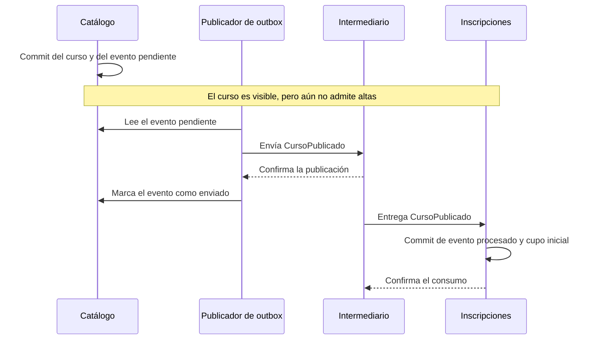

# Solución 07: entrega y procesamiento de CursoPublicado

Este diseño aplica solo si se extrae Catálogo según el [ADR 002](adr/002-extraccion-catalogo.md). No requiere cambios en el monolito del laboratorio.

## Secuencia

El curso admite altas desde el commit de Inscripciones, aunque todavía no se haya confirmado el consumo al intermediario. La confirmación de publicación y la de consumo son independientes: marcar el outbox como enviado no prueba que el cupo exista.

## Contrato v1

Catálogo produce el evento e Inscripciones lo consume con entrega al menos una vez. Todos los campos del [ejemplo de la lección](07-comunicacion-entre-servicios.md#contrato-propuesto-curso-publicado) son obligatorios:

| Campo | Regla |
| --- | --- |
| `eventoId` | UUID del evento lógico. Se conserva en cada reintento de publicación. |
| `tipo`, `version` | `CursoPublicado` y el entero `1`. |
| `cursoId` | Identificador entero positivo del curso. |
| `cupoInicial` | Entero no negativo. Solo inicializa el cupo; no expresa cuántos lugares quedan. |

El consumidor valida antes de escribir. Una versión desconocida o un mensaje inválido se registra como fallo y se deriva a revisión sin tocar el cupo ni reintentarlo indefinidamente.

## Regla de consumo

En una transacción local, intenta registrar el `eventoId` con una restricción única. Si ya existe, no modifica el cupo. Si es nuevo, intenta insertar el cupo inicial con unicidad por `cursoId`; si el curso ya tiene cupo, no actualiza los lugares restantes. Si la transacción falla, no se confirma el consumo y el mensaje puede reintentarse. Un cambio real de capacidad necesita otro contrato.

## Casos de verificación

| Caso | Resultado esperado |
| --- | --- |
| El intermediario no está disponible tras el commit de Catálogo. | El evento sigue pendiente en el outbox. El curso es visible, pero no acepta altas hasta aprovisionarse. |
| El publicador cae tras enviar y antes de marcar la fila. | Reenvía el mismo `eventoId`; Inscripciones no aplica el efecto dos veces. |
| Se confirma el cupo inicial de 20, se inscribe un alumno y se vuelve a entregar el evento. | Quedan 19 cupos, no 20. Un segundo evento con otro ID para el mismo curso tampoco repone lugares. |
| El consumidor cae después del commit y antes de confirmar el consumo. | La nueva entrega encuentra el `eventoId` registrado y no vuelve a escribir el cupo. |
| Catálogo cae cuando el curso ya está habilitado. | El POST de inscripción sigue operando con datos locales; las publicaciones nuevas quedan pendientes hasta que Catálogo vuelva. |

Son resultados esperados del diseño, no pruebas ejecutadas contra un intermediario.
