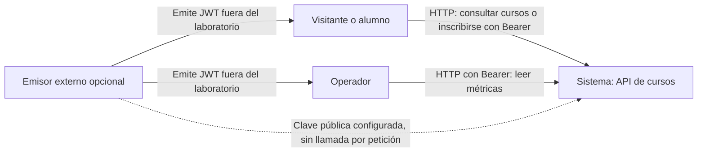
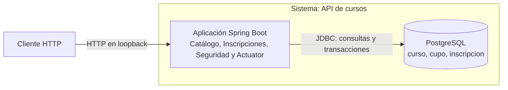
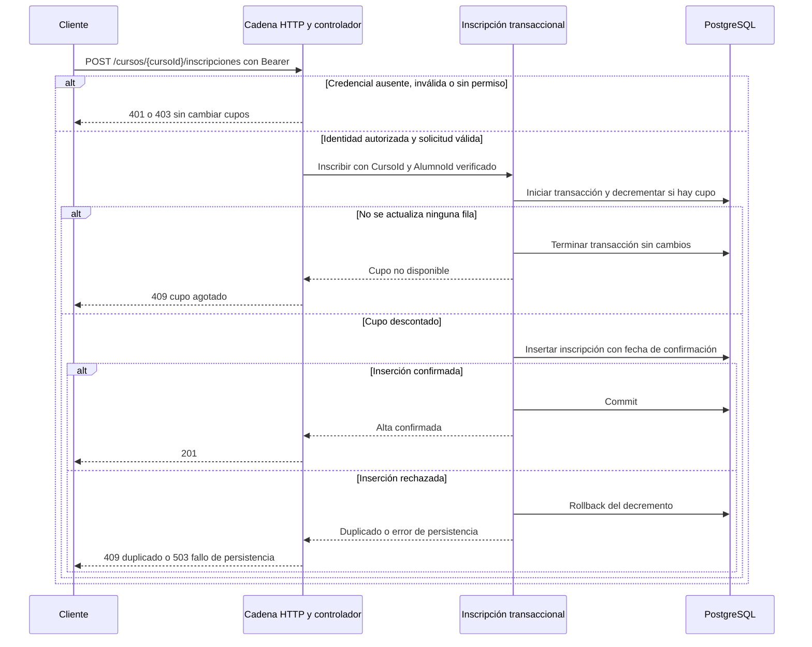

# Arquitectura del último cupo

Esta guía describe el sistema **actual**. Para arrancar la aplicación, configurar un emisor de prueba o consultar métricas, usa el [README del laboratorio](README.md).

## Contexto

La lectura del catálogo es pública. Sin configuración de un emisor de confianza, no se aceptan tokens. Con esa configuración, la API valida el JWT localmente y vincula su sujeto a un alumno para inscribir. El permiso de lectura de métricas es independiente del permiso de inscripción.

## Contenedores

Hay una sola aplicación, no un despliegue por módulo. Catálogo consulta `curso`; Inscripciones controla `cupo` e `inscripcion`. Flyway versiona el esquema. El [ADR 001](../../courses/backend-java-spring/04-arquitectura-de-software/adr/001-monolito-modular.md) explica la elección del monolito. El [ADR 002](../../courses/backend-java-spring/04-arquitectura-de-software/adr/002-extraccion-catalogo.md) conserva esa decisión y documenta una extracción **no implementada**. Tampoco hay un intermediario de mensajes ni un exportador de trazas.

## Secuencia de inscripción

La validación del token y el permiso están en [SeguridadApi](src/main/java/dev/learning/cursos/seguridad/SeguridadApi.java). El [controlador](src/main/java/dev/learning/cursos/inscripciones/InscripcionesController.java) resuelve el alumno del lado del servidor. [InscripcionTransaccional](src/main/java/dev/learning/cursos/inscripciones/InscripcionTransaccional.java) delimita la transacción y el [repositorio](src/main/java/dev/learning/cursos/inscripciones/InscripcionesRepository.java) ejecuta las dos operaciones SQL. El controlador registra el resultado después de que la llamada transaccional retorna o falla. La secuencia es documentación, no una traza capturada.

## Garantías y evidencia

| Garantía | Prueba y resultado esperado |
| --- | --- |
| Dos solicitudes no toman el mismo último cupo. | [InscripcionesTest](src/test/java/dev/learning/cursos/InscripcionesTest.java): `soloConfirmaUnaInscripcionParaElUltimoCupo` exige HTTP 201 y 409, cero cupos y una sola inscripción. |
| Un duplicado o un fallo de inserción no consume otro lugar. | [InscripcionesTest](src/test/java/dev/learning/cursos/InscripcionesTest.java): `unaInscripcionDuplicadaNoConsumeOtroCupo` y `distingueFalloDePostgresYRevierteElCupo`. |
| Un permiso insuficiente no permite inscribir ni consume cupo. | [InscripcionesTest](src/test/java/dev/learning/cursos/InscripcionesTest.java): `rechazaIdentidadSinPermisoOSinVinculoSinConsumirCupo`. |
| Las métricas tienen un permiso propio y el log se correlaciona con la respuesta. | [InscripcionesTest](src/test/java/dev/learning/cursos/InscripcionesTest.java): `registraResultadosConCorrelacionYProtegeLasMetricas` verifica el 403, la consulta autorizada y `X-Request-Id`. |
| La adopción de Flyway conserva una inscripción histórica sin inventar su fecha. | [MigracionesTest](src/test/java/dev/learning/cursos/MigracionesTest.java): `conservaLaInscripcionHistoricaAlAdoptarV1` verifica la fila, el cupo y la fecha nula. |

Si un PR cambia un permiso, un contrato HTTP, la propiedad de una tabla o el límite de la transacción, revisa la vista y la prueba correspondiente en ese mismo PR. Si cambia una decisión, registra el motivo en un ADR.
